# Wireframes

Low-to-mid fidelity SVG wireframes for every BonVoyage screen. They are greyscale boxes with real labels and demo-seed sample data, not final design: layout, content and states are what later prompts build against; spacing and styling will change. `docs/design` remains the frozen UML baseline (tag `design-baseline-v1`); these files supplement it, they do not replace it.

Sample data comes from the demo seed: trip "Long weekend in the hills", origin Gurugram, 2 nights, group budget ₹48,000, radius 450 km, members Asha (organiser), Rohan and Meera.

## Screen map

SRS 3.1.1 names five screens (trip dashboard, preference submission form, ranked destination shortlist, package comparison view, day-wise itinerary view); all five are covered, plus the supporting screens Sprint 1 needs. No SRS screen was missing.

| File | Route | Built in | Requirements | States shown | SRS 3.1.1 screen |
| --- | --- | --- | --- | --- | --- |
| 01-sign-in.svg | /sign-in, /sign-up | S1-1 | R1, R10 | default, error slot, sign-up variant | none |
| 02-trips.svg | /trips | S1-2 | R2, R9 | list, empty, loading | none |
| 03-trip-new.svg | /trips/new | S1-2 | R9 | default, field error | none |
| 04-join.svg | /join/:token | S1-3 | R2 | default, signed-out, expired link | none |
| 05-preferences.svg | /trips/:id/preferences | S1-4 | R3 | default, field error | preference submission form |
| 06-dashboard.svg | /trips/:id | S1-5 | R2, R3 | collecting, error, per-person money | trip dashboard |
| 07-shortlist.svg | /trips/:id/shortlist | S2 | R6, R7 | ranked list | ranked destination shortlist |
| 08-shortlist-empty.svg | /trips/:id/shortlist | S2 | R5, R6 | fewer than 3 feasible | ranked destination shortlist (empty) |
| 09-packages.svg | /trips/:id/packages | S3 | R8 | two packages, over-budget, member tally | package comparison view |
| 10-itinerary.svg | /trips/:id/itinerary | S4 | R12, R13 | day timeline, provenance tags | day-wise itinerary view |
| 06-dashboard-desktop.svg | /trips/:id | S1-5 | R2, R3 | two-column desktop | trip dashboard |
| 09-packages-desktop.svg | /trips/:id/packages | S3 | R8 | three-column desktop | package comparison view |
| 10-itinerary-desktop.svg | /trips/:id/itinerary | S4 | R12, R13 | desktop with day column | day-wise itinerary view |

The loading state (skeleton rows) is the inset on 02-trips; the error state (alert with Retry) is the inset on 06-dashboard.

## Screens and notes

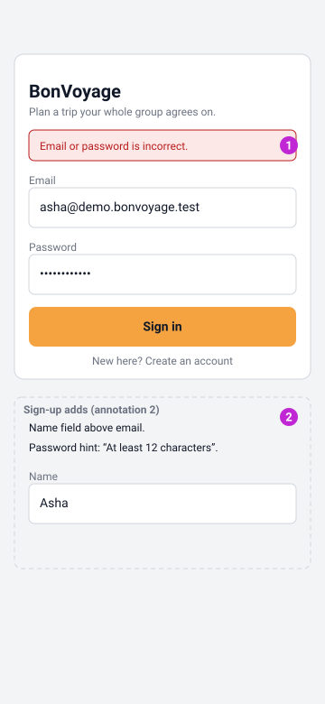

1. Error alert slot above the form (`UNAUTHENTICATED` copy: "Email or password is incorrect.").
2. Sign-up variant: adds a Name field above Email and the password hint "At least 12 characters".

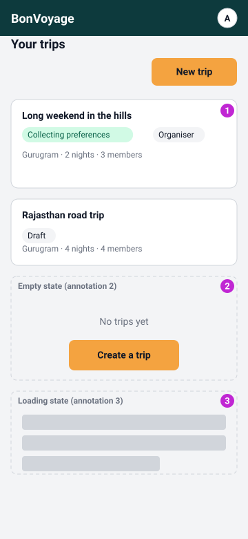

1. Status is a badge with the status name in words, never colour alone.
2. Empty state inset: "No trips yet" plus the create button.
3. Loading inset: skeleton rows while the list query runs.

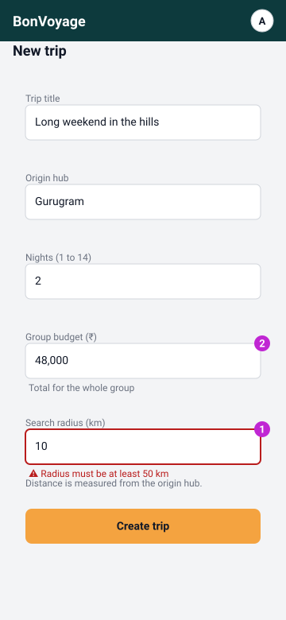

1. Field error pattern: red border plus an icon plus a message, never colour alone; error and helper lines stay at least 18 px apart.
2. Helpers keep units plain: budget is the whole-group total, radius is the road distance from the starting city ("How far from your starting city you are willing to travel by road").

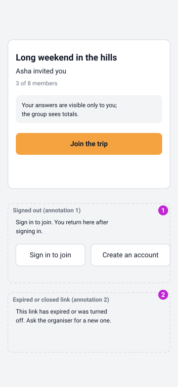

1. Signed-out inset: "Sign in to join" beside "Create an account"; either route returns to the join page.
2. Expired or turned-off link inset: "This link has expired or was turned off. Ask the organiser for a new one."

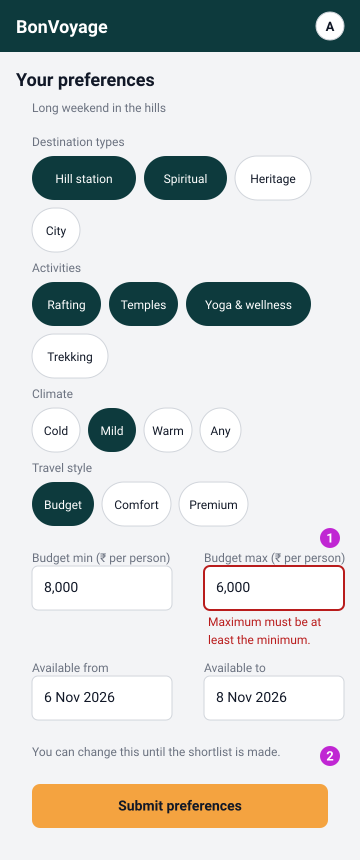

1. Budget max error: "Maximum must be at least the minimum" wrapped on two lines under the field; chips are 44 px tall and wrap to a second row rather than overflow.
2. The editable note mirrors the T3/I1 rule: preferences can change until the shortlist runs.

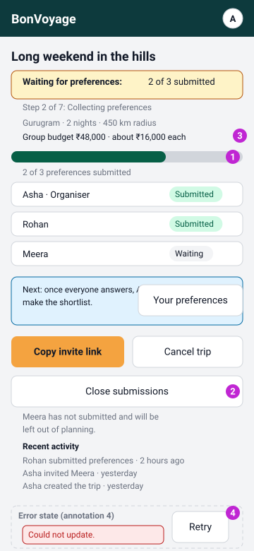

1. The progress bar always repeats its numbers as text ("2 of 3 preferences submitted"); the step line under the banner reads "Step 2 of 7: Collecting preferences".
2. "Close submissions" is a secondary action, enabled once two members have submitted, with the consequence in words: "Meera has not submitted and will be left out of planning."
3. Money shows the group total and the per-person figure; the next-step callout reads "Waiting for Meera." with a full-width "Edit your preferences" button below it (Asha has already submitted), and the "Recent activity" list sits above the error inset.
4. Error inset: alert with a Retry action for the live refresh.

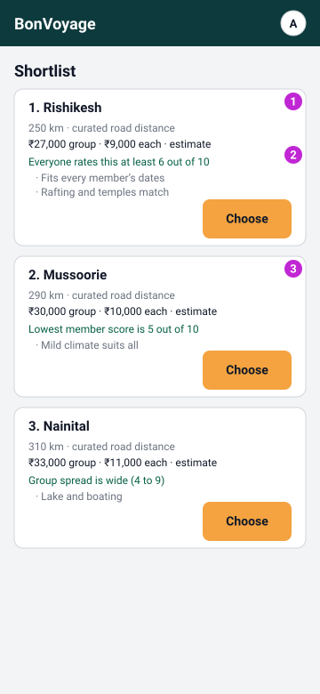

1. Distance carries its provenance ("curated road distance").
2. Cost shows group total, per person and the word "estimate".
3. The group-fit score is explained in words, not a bare number.

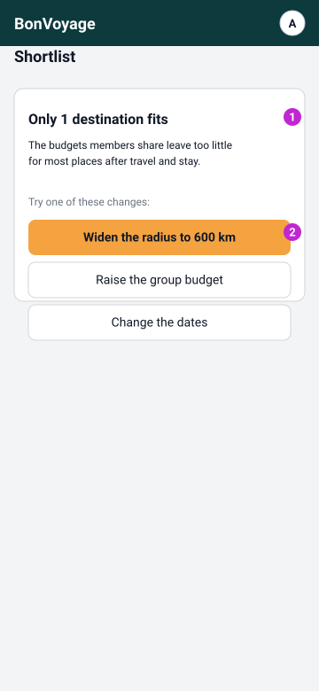

1. The binding constraint is stated in plain words when fewer than 3 destinations fit.
2. Each suggestion is an action button (widen radius, raise budget, change dates).

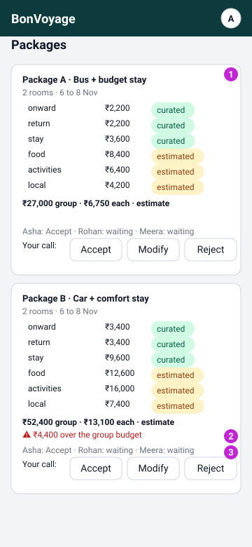

1. Every cost line carries its provenance tag (curated or estimated).
2. An over-budget package says so in words.
3. Each member's Accept / Modify / Reject shows with a live tally.

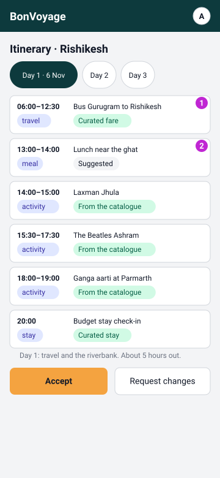

1. Every item carries a provenance tag: "From the catalogue", "Curated fare", "Curated stay" or "Suggested".
2. Travel legs are their own timeline items, matching the validator's onward/return rule; the day tabs are 44 px tap targets.

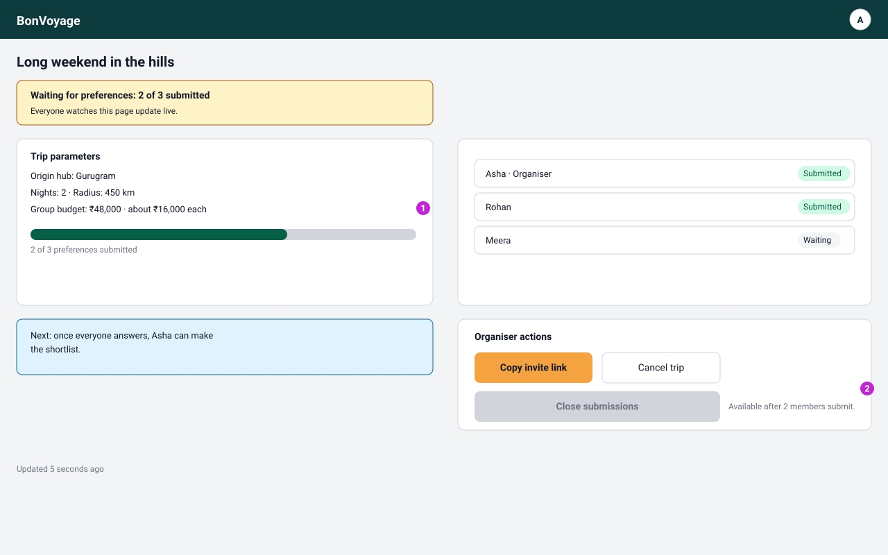

1. Two columns: parameters and progress left, roster right; step line under the banner, "Recent activity" card bottom left.
2. Organiser actions bottom right; "Close submissions" is enabled secondary with the "Meera has not submitted" note in words.

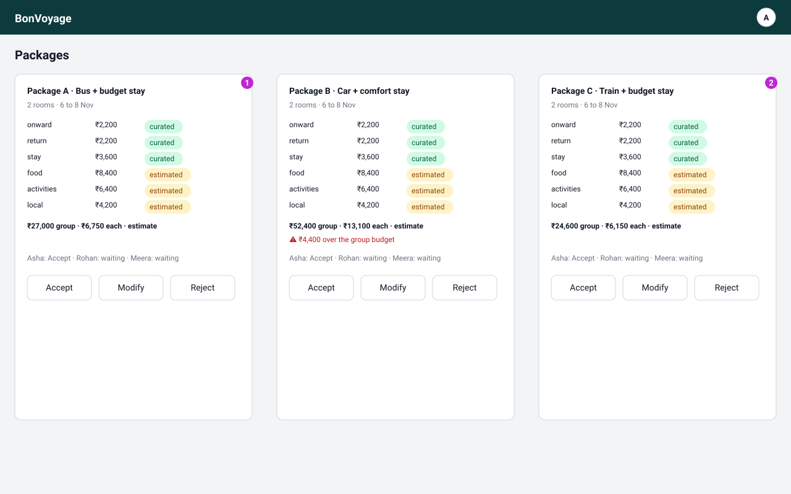

1. Three package cards side by side, same cost breakdown and provenance.
2. Over-budget warning repeated on the expensive option.

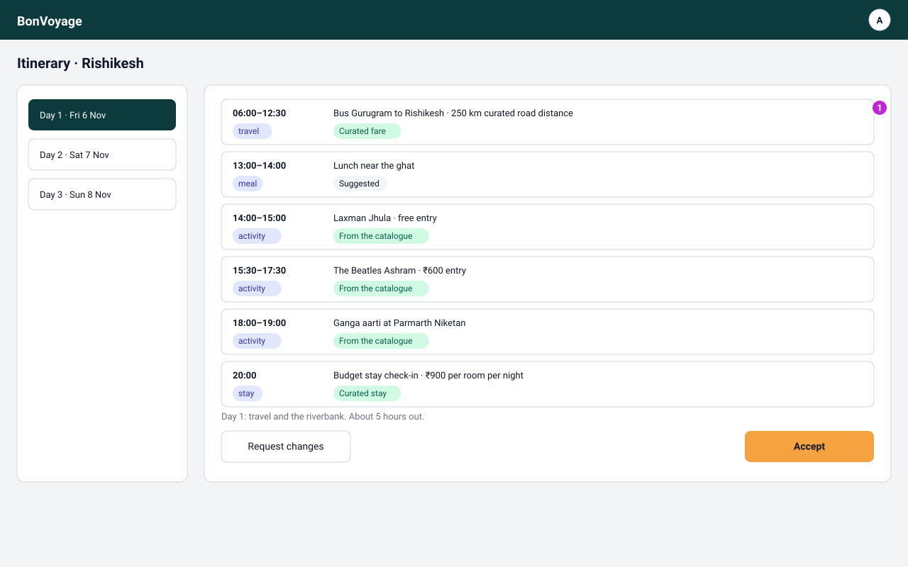

1. Day navigation becomes a column; the timeline keeps the same item anatomy.

## Shared patterns

- **App header:** product name left, user menu avatar right, on every screen except 01 (sign-in) and 04 (join), which are pre-membership.
- **Status badges:** trip status always appears in words: `draft`, `collecting preferences`, `ready for recommendation`, `shortlisted`, `packages proposed`, `package selected`, `itinerary proposed`, `finalised`, `in progress`, `completed`, `cancelled` (from `TRIP_STATUSES`), never by colour alone.
- **Money:** every figure shows the group total, the per-person amount and the word "estimate" (`formatInr`, Indian grouping, no decimals).
- **Loading:** skeleton rows in place of content.
- **Empty:** a short sentence plus the one action that fixes it.
- **Error:** an alert slot with the message in words and a Retry action.
- **Form errors:** red border plus icon plus message, linked by `aria-describedby`; never colour alone.
- **Touch targets:** every tap target drawn at least 44 px tall; 16 px margins at 360 px; nothing wider than the frame.
- **Annotations:** numbered magenta circles are documentation, not UI.

## Open questions

- Should the packages screen also show the rejected-package state once R13's decisions land, or is the per-member tally enough for Sprint 3?
- The dashboard poll interval (10 s per issue #33) is assumed in the desktop "Updated 5 seconds ago"; confirm the cadence still stands.
